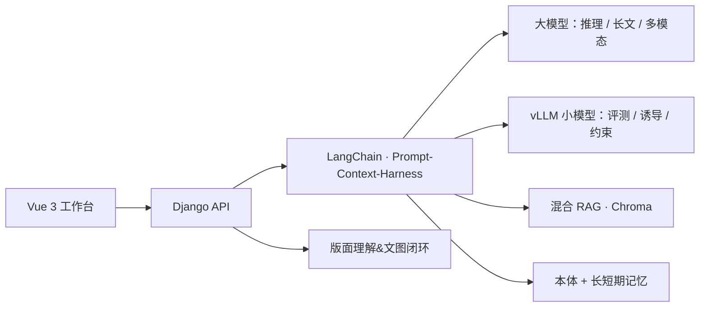

# NKCN·Brain

<p align="center">
  <b>知识本体语义空间与多智能体认知系统</b><br/>
  <i>Domain ontology, hybrid RAG, and a multi-agent cognitive workbench</i>
</p>

<p align="center">
  <a href="#nkcnbrain">中文</a> ·
  <a href="#nkcnbrain-english">English</a>
</p>

<p align="center">
  
  
  
  
  
  
</p>

---

## NKCNBrain

NKCN·Brain（2024.04 – 2026.09，当前 **V3.2**）是一套基于**领域本体**的多智能体认知系统：把多模型对话、文档、复杂版面、神经元卡片和群体协作，收进可计算的语义空间。

它要解决的是大模型落地里反复出现的三类问题——**长上下文腐烂**、**检索噪声幻觉**、**异构模型协同**。通过 LangChain 编排 + 混合 RAG + vLLM 小模型约束 + 本体/长短期记忆，而不是把所有东西一次性塞进 Prompt。系统覆盖设计、研究、跨模态理解、课程协作和领域数据集构建，并制备微调/评测数据，推进弱到强对齐。

七类场景：阅读、学习、创作、设计、研究、物联互动、领域数据集构建。

### 技术要点

**多模型编排与 Prompt–Context–Harness**  
按任务把复杂推理、长文、多模态交给大模型规划与理解；评测、诱导、约束由 vLLM 本地 serving 的小模型承接。多层记忆与 RAG 按预算精细注入，再加结构化输出，驱动多阶段 Agent。红蓝卡标使用 GCS+D（Goodness / Confidence / Decay），GCS 与腐烂度分路输入约节省 **37.5% Token**。

**混合 RAG**  
文档预摘要索引 + 小模型抽取关键词定位段落 + Embedding/Chroma 向量召回，并与约 **30%** 传统相似度检索混合，避免纯向量不可控、便于调控信息熵。综合召回、命中、排序质量加权后，难题子集相对基线约 **+16%**，难负例命中约 **−17%**。

**知识本体与长短期记忆**  
实体—关系—行为分层存储（MySQL + JSON / Markdown）。记忆按 **用户 — 场景 — 本子/会话** 持久化，支持跨场景检索，以及分级、索引、整合、剪枝。该留的进白区，可压可溯的进灰区，该忘的进黑区——记忆走出「只写在 Prompt 里」。

**复杂版面解析与智能评阅**  
多模态细/中/粗粒度嵌套标注 + ROI 裁剪 + 生成—评判—仲裁（LLM-as-Judge）交叉校验。复杂测试集约 **90%–95%**，标准集约 **98%**。智能评阅另有版面 / 理解 / 评阅三步链路。

### 系统能力

| 方向 | 现在能看到的东西 |
| --- | --- |
| 多模型工作台 | GPT / Claude / Gemini / DeepSeek / Kimi / Llama / Qwen 等并行；三窗口综合；大小模型类弱到强对齐 |
| 神经元卡片 | 白卡 → 浅卡 → 深卡；红蓝分、迭代链、前后置索引、置信度与腐烂度 |
| 四色 / DMT | 红业务 / 蓝工具 / 紫思维 / 绿自然语言；D 短期 / M 中期 / T 长期；文档三级筛分 |
| 小中大本体 | 卡片抽词；本子核心问题与关键词连线；场景 / 任务簇大本体节点图 |
| 长短期记忆 | 账户画像、场景/本子 MEMORY 与规矩、日记；压缩、升白、定期整理（AutoDream） |
| 混合 RAG | PreSummary + Tab 关键词定位 + Chroma，与传统相似度混合 |
| 文图闭环 | 构图 → 生图 → 连续图像理解 |
| 版面与评阅 | DMT 微版面覆盖层、白灰黑识别、选手—裁判—仲裁；Skill 化评阅与 HTML 报告 |
| 课程大脑真实实践 | 飞书助教、精进种子、小组本体、跨本任务簇 |
| 群体知识 | 共生评测、群组本子、隐性知识、目录卡 / 综合报告 |

### 架构一览



前端是场景本子与卡片工作台；后端负责编排、检索、记忆和评阅。持久化在 MySQL 与运行期记忆文件里，向量在 Chroma。密钥走 `.env`，不进仓库。

### 长短期记忆

日记—精华—规矩分轨，把记忆从 Prompt 里拿出来，按账户 / 场景 / 本子落盘，问答时按预算注入。

| 层 | 记什么 |
| --- | --- |
| 账户 | 交互偏好、认知状态、最近在做的场景与问题链 |
| 场景 | 跨本子仍成立的精华与边界（MEMORY / 规矩） |
| 本子 | 长期精华、本子规矩、按日日记 |

闭环是 **用 → 写 → 压 → 升**：发问前注入；回合后抽取；窗口紧时先落盘再压缩；定期整合剪枝，抑制记忆漂移。

### 嵌入式课程大脑真实实践

| 版本 | 增强能力 |
| --- | --- |
| V2.96 | 群组课设批改、准自动化 |
| V3.0 | 大小模型对齐常态化、红蓝卡标客观化、vLLM 秒级响应 |
| V3.1 | 四色 DMT 三级筛分、关键词节点图、神经元深卡、目录卡、隐性知识、OCR |
| V3.15 | 文图闭环、DMT 微版面、白灰黑识别 |
| **V3.2** | 小中大本体、任务簇跨本、课程大脑、群组评阅、主体性长短记忆 |

更细的沿革、Prompt 与代码位置见 [项目总结主文档](NKCNBrain说明文档/NKCN·Brain项目总结主文档（至V3.2）.pdf)。

### 仓库

```text
frontend/                 Vue 3：登录、场景本子、对话、卡片、Seed、评阅...等
backend/                  Django：LLM 编排、RAG、本体语义抽取、记忆构建、连续图像理解...等
small_llm_deep_judge/     OCR 与 vLLM 小模型精炼 / 深评
NKCNBrain说明文档/         项目总结
```

### 快速开始

Python 3.10+ · Node.js 18+ · MySQL 8；OCR / vLLM 可选。

```bash
git clone https://github.com/liangyifeng-nankai/NKCNBrain.git
cd NKCNBrain
cp .env.example .env          # 填 MySQL 密码和模型 API Key
```

后端：

```bash
cd backend
python -m venv .venv
# Windows: .venv\Scripts\activate
source .venv/bin/activate
pip install django django-cors-headers mysqlclient langchain langchain-core pillow python-dotenv
python manage.py migrate
python manage.py runserver 0.0.0.0:8000
```

前端：

```bash
cd frontend
npm install
npm run serve
```

默认请求 `http://localhost:8000`。模型 JSON 只写 `env:变量名`。

### 文档与许可

- [项目总结主文档](NKCNBrain说明文档/NKCN·Brain项目总结主文档（至V3.2）.pdf)

Issue / PR 欢迎。许可证由仓库所有者确定；`LICENSE` 发布前请勿默认可任意商用。

---

## NKCNBrain (English)

NKCN·Brain (Apr 2024 – Sep 2026, **V3.2**) is a **domain-ontology multi-agent cognitive system**. It folds multi-model dialogue, documents, complex layouts, neuron cards, and group collaboration into a computable semantic space.

It targets three recurring failures in LLM applications — **long-context rot**, **noisy-retrieval hallucination**, and **heterogeneous model coordination** — via LangChain orchestration, hybrid RAG, vLLM-served small-model constraints, and ontology / long–short-term memory, instead of stuffing everything into one prompt. The system covers design, research, cross-modal understanding, course collaboration, and domain dataset construction, and also prepares fine-tuning / evaluation data toward weak-to-strong alignment.

Seven scene families: reading, learning, creation, design, research, IoT interaction, and domain dataset building.

**Multi-model orchestration and Prompt–Context–Harness.** Large models plan and understand hard reasoning, long documents, and multimodality; locally served vLLM small models take evaluation, induction, and constraints. Multi-layer memory and RAG are injected under token budgets, plus structured outputs, to drive multi-stage agents. Red–blue scoring uses GCS+D (Goodness / Confidence / Decay); splitting GCS from decay saves about **37.5% tokens**.

**Hybrid RAG.** Document pre-summary indexes + small-model keyword routing to passages + Embedding/Chroma recall, mixed with ~**30%** classical similarity so pure-vector retrieval is not left unchecked and information entropy stays tunable. Weighted recall / hit / ranking quality: about **+16%** vs baseline on a hard subset, about **−17%** hard-negative hits.

**Ontology and long–short-term memory.** Entity–relation–behavior layers (MySQL + JSON / Markdown). Memory persists by **user — scene — notebook/session**, with cross-scene retrieval plus ranking, indexing, merge, and prune. Keep in white, compress-with-trace in gray, forget in black — memory is no longer “only in the prompt.”

**Complex layout parsing and intelligent review.** Nested fine/mid/coarse multimodal annotations + ROI crops + generate–judge–arbitrate (LLM-as-Judge). About **90%–95%** on a complex set, **~98%** on a standard set. Review itself has a three-stage layout / understanding / review pipeline.

**Capabilities.** Multi-model workbench (GPT / Claude / Gemini / DeepSeek / Kimi / Llama / Qwen, three-window synthesis, weak-to-strong-*style* alignment) · neuron cards (white → shallow → deep) · four-color DMT · small/mid/large ontologies · long–short-term memory (user profile, scene/notebook MEMORY and rules, diaries, AutoDream) · hybrid RAG · image–text loops (compose → generate → continuous-image understanding) · layout review (DMT overlays, white/gray/black, player–judge–arbitrate, skill-based review and HTML reports) · embedded course-brain practice (Feishu TA, improvement seeds, group ontology, cross-notebook task clusters) · collective knowledge (co-evaluation, group notebooks, tacit knowledge, catalog cards / reports).

**Architecture.** Vue 3 scene/notebook card workbench → Django API → LangChain harness, large models, vLLM small models, hybrid RAG, ontology/memory; layout understanding and image–text loops sit beside the harness. State lives in MySQL and runtime memory files; vectors in Chroma. Secrets stay in `.env`.

**Memory.** Diaries, distilled MEMORY, and rules on separate tracks, persisted by user / scene / notebook and injected under budget. Loop: **use → write → compact → promote** (inject before the turn, extract after, flush then compress when the window is tight, periodically merge and prune).

**Embedded course-brain practice.** V2.96 group course-project review · V3.0 large–small alignment and objective red–blue scoring · V3.1 four-color DMT, keyword graphs, deep cards, catalog cards, tacit knowledge, OCR · V3.15 image–text loops and DMT micro-layouts · **V3.2** small/mid/large ontology, cross-notebook task clusters, course brain, group review, and subject-centered long/short-term memory.

Setup matches the Chinese section: copy `.env.example` → `.env`, Django on `:8000`, then `npm install && npm run serve` in `frontend/`. Summary document: [NKCN·Brain项目总结主文档（至V3.2）.pdf](NKCNBrain说明文档/NKCN·Brain项目总结主文档（至V3.2）.pdf).

---

<p align="center">
  NKCN·Brain · 2024.04 – 2026.09<br/>
  <a href="https://github.com/liangyifeng-nankai/NKCNBrain">github.com/liangyifeng-nankai/NKCNBrain</a>
</p>